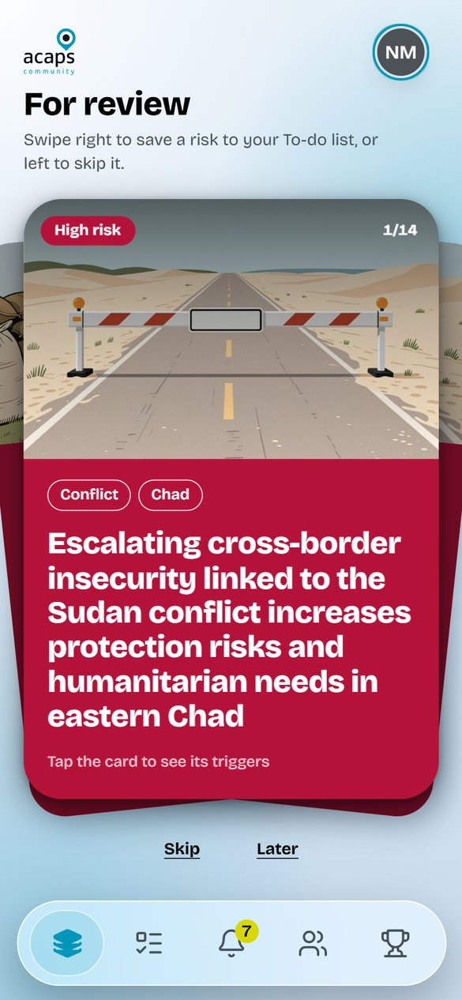
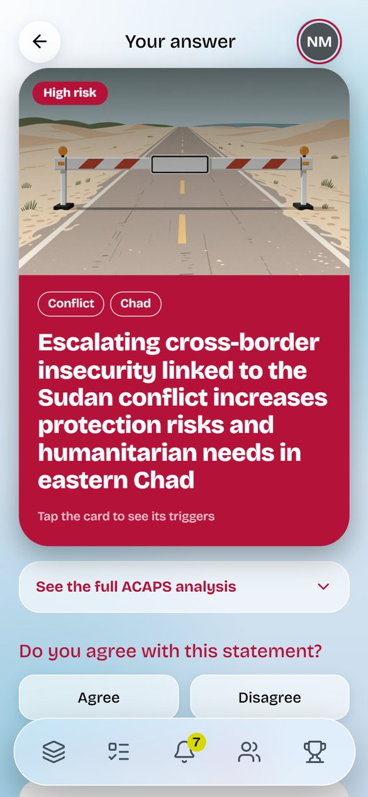
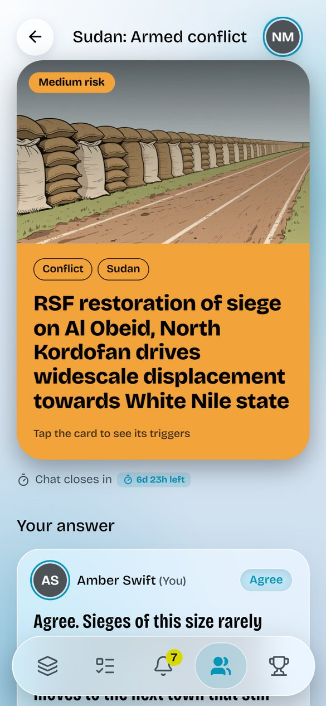
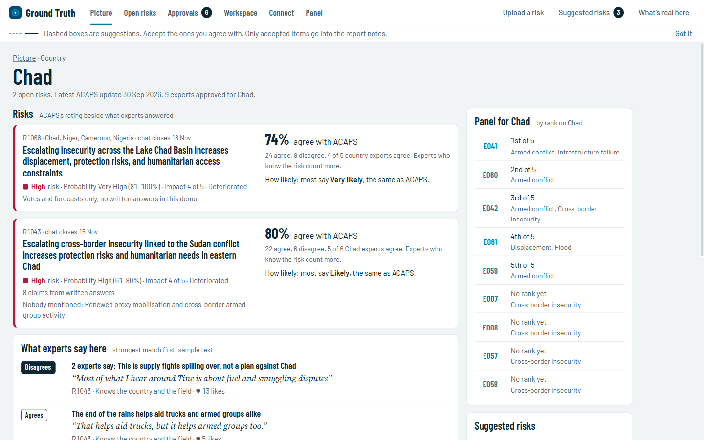
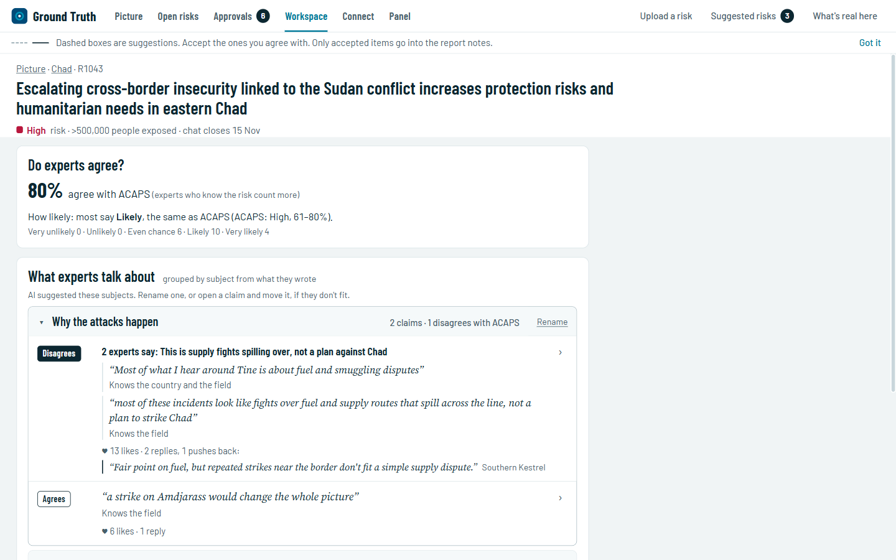

# ACAPS Community

A small, moderated network of humanitarian experts who check and forecast ACAPS risk analyses in a few minutes, while each expert controls their own anonymity.

Built for [ACAPS](https://www.acaps.org/) at Hackathon for Good #8, The Hague, 6-8 November 2026. Read the [challenge brief](docs/challenge-brief.md).

**Try it, nothing to install:** [website](https://mellow-pithivier-3abcbb.netlify.app) · [expert app](https://mellow-pithivier-3abcbb.netlify.app/app) · [analyst view](https://mellow-pithivier-3abcbb.netlify.app/analyst) · [demo video](https://youtu.be/tfIt53hhEKY)

The expert app's login accepts any username and password. Everything runs on simulated data, and changes reset when the page reloads.

<p align="center">
  
  
  
</p>

The expert app: a risk card, a short answer, and the risk's chat, where the expert appears under a name used only on that risk.

## The problem

ACAPS rates risks that could start a humanitarian crisis or sharply worsen one. Its analysts work from public sources and a few expert conversations, then publish. The people closest to a crisis often sense a risk before it reaches a report, but that knowledge stays in informal chats, and ACAPS cannot learn whose judgement holds up. These experts are busy, and some work in sensitive places, so they won't use a tool that takes their time or exposes them.

## How it works

The demo follows R1043, cross-border insecurity in eastern Chad.

1. **ACAPS approves each expert** for the countries and domains they know. An expert can hold one or several of each, because expertise often comes from where someone has lived and worked.
2. **Risks arrive as cards.** An expert gets a card when a risk matches their country or domain. Cards are ordered by urgency, then by how well the risk matches the expert. Swiping right saves a card to the To-do list, and swiping left skips it.
3. **A short answer.** The expert agrees or disagrees with ACAPS's statement, says how likely the risk is, and can add a written answer and sources.
4. **The discussion.** Answering opens that risk's chat, where experts read each other's answers, like them and reply. Nobody sees how others voted until the chat closes.
5. **The group view.** When the chat closes, experts see the moderator's summary, the share who agree, what country experts said, and the panel's forecast.
6. **The outcome.** ACAPS records what happened, and experts get an alert, see the result and earn points.

The app works in English, French, Spanish, Portuguese and Arabic. On a slow or metered connection it switches to a low-data mode without images or effects.

### What ACAPS gets from each risk

Every expert's vote counts, but a vote from someone who knows the country and the domain counts for more.

| Expert's match to the risk | Weight |
|---|---|
| Country and domain | 1.0 |
| Country only | 0.6 |
| Domain only | 0.4 |

When the chat closes, the group view shows the share who agree, counted by weight, and a separate line for the country's own experts. In the demo, from simulated votes, R1043 stands at:

> **80% agree**

Country experts are the small panel ACAPS asked for, and domain-only experts add a wider view at a lower weight. The country line stays empty under 3 answers, because in a smaller group it could show how one person voted. R1043's chat is still open in the demo, so its result shows in the analyst view rather than in the expert app.

### What the moderator does

ACAPS's moderator works in the analyst view, part of the same frontend: run `npm run dev` in `frontend/` and open http://localhost:5173/analyst. A single-file copy, [`analyst/acaps_community_analyst_view.html`](analyst/acaps_community_analyst_view.html), opens in a browser with nothing to install.



| Screen | What it holds |
|---|---|
| Picture | A map of the open risks. Click a country to open its page |
| Country | Each risk next to how many experts agree with ACAPS and how likely most think it is, what experts say across the country's risks, links to other risks, and the country's panel |
| Open risks | Votes, answers, likes and turnout on every open risk |
| Risk | One risk: whether experts agree with ACAPS, and what they say, grouped by subject with the best-matched experts first |
| Approvals | People who applied, with what they sent. Approve or deny each country and field |
| Connect | Links between risks, each with a stated cause, which the moderator confirms or rejects |
| Panel | Panel numbers, ranks by code, and each expert's account |
| Custom dashboard | A board the moderator arranges from widgets, such as risks closing soonest, lowest turnout, agreement with ACAPS and top forecasters |
| Upload a risk | A new risk, with a preview of the card and a count of the experts who will get it |
| Suggested risks | Risks that experts proposed from the app, waiting for the moderator |



The AI summaries and groupings in the demo were written in advance, and nothing reaches the report notes until a person accepts it. Every answer shows the expert's code, which opens their account. The account shows name, email and organisation only for experts who aren't fully anonymous. For "Verified, then deleted", ACAPS keeps only the code and the activity.

The analyst view reads a fixed demo file, `frontend/src/analyst/data/analyst-data.json`, which does not change when the data is rebuilt.

### Anonymity

Nothing an expert writes is ever shown to the public. Anonymity has two sides.

**What other experts see.** The expert chooses in the app's settings, and can change it at any time: their name, a pseudonym, or "Anonymous expert". A pseudonym is different on every risk, so two discussions cannot be linked through a name.

**What ACAPS keeps.** Each expert has one of three levels, and the analyst view shows which.

| Level | What ACAPS keeps |
|---|---|
| Known to ACAPS | Personal data. The expert can hide their name on a single answer, and ACAPS still sees and uses the answer |
| Verified anonymous | Name, email and organisation, shown to ACAPS moderators only, never to other experts |
| Verified, then deleted | No personal data after review. Contact details, documents, the application comment and education are deleted |

Every expert gets a secret 12-word recovery code, and only its hash is stored, so an expert whose contact details are deleted can still get back into their account. The demo app signs in with a username and password, and its sign-up form does not ask for the level yet.

### Points and rank

| Forecast | Right | Wrong |
|---|---|---|
| Very likely or Very unlikely | +3 | -7 |
| Likely or Unlikely | +2 | -3 |
| Even chance | 0 | 0 |

"Right" works in both directions: Unlikely on something that did not happen earns the same as Likely on something that did. A spot-on comment earns +5. The demo has one hand-set example, and the app has no screen for choosing them yet.

Each risk's chat has a deadline set by ACAPS, when answers lock and experts see the group results. Points come later, when the risk happens or its months run out, and use each expert's last answer from before the date it happened, so nobody earns points by reading the news.

Rank is the average points per scored forecast, so answering more cannot buy a higher position. An expert needs 5 scored forecasts to get a position. Each expert sees only their own rank, and ACAPS sees all of them.

## Does the scoring work?

We tested it on the real outcomes of 104 past ACAPS risks, using 76 simulated experts whose skill we set in advance.

- Rank matched the skill we set closely, with a rank correlation of 0.76.
- The top 8 experts had an average skill of 0.79, against 0.57 for all 67 experts with a position.

This shows the scoring can find skilled experts when they exist. It says nothing about how real experts will do, because the simulation was told how skilled each expert is. The export also has no date for when a past risk happened, so each past risk gets a simulated window of up to six months within the last year.

## What is real and what is simulated

| Real, from the ACAPS Risk Radar export | Simulated |
|---|---|
| 139 risks across 57 countries, including 28 active risks and 104 past risks with known outcomes | Every expert, vote, comment and forecast |
| Triggers, ratings and what happened | Approvals, anonymity choices and display names |

No real person is in the data. The expert comments, replies and suggested cards are sample text. We set the demo expert's skill high, so the Ranking screen shows a top place.

## Before a pilot

The app runs on generated files, with no server or real login yet, so anything done in it lasts until the page reloads. These questions are still open:

- **Forecast questions need a clear rule.** Each question must say what counts as happening, and by when. The conditions in ACAPS's triggers are a good starting point.
- **Points arrive late.** They only come with outcomes, and the pilot runs for about two months, so experts need another reason to return before then. Alert data exists, but nothing delivers alerts yet.
- **Country panels come first.** In the simulated data, a typical risk has only 2 or 3 answers from country experts, and one open risk has none.
- **The weights are an assumption.** ACAPS should test them during the pilot. The simulation cannot show that local experts are more accurate, because we set that ourselves.
- **Sign-up needs the anonymity level.** The data model and the analyst view have the three levels, but the sign-up form does not ask for one, and sign-in still uses a password instead of the recovery code.
- **Verified anonymous depends on access.** Moderators see these experts' name, email and organisation in their accounts, so ACAPS must limit who can open the analyst view.
- **The analyst view needs a server.** Today it reads a fixed demo file.

## Run it

Tested on Python 3.12.

```bash
pip install -r requirements.txt
python src/build_demo_data.py   # rebuilds data/synthetic/ and app/data/
python -m pytest tests          # 174 tests

cd frontend
npm install
npm run dev                     # website at http://localhost:5173, app at /app, analyst view at /analyst
```

The single-file analyst view, `analyst/acaps_community_analyst_view.html`, needs no build: open it in a browser.

Use `build_demo_data.py` to rebuild the data. The save cell in notebook 05 writes the app file without ranks.

## What's in this repo

| Path | What it holds |
|---|---|
| `src/synthetic_data.py` | Builds the simulated tables |
| `src/points.py` | Points, ranks, card order and results |
| `src/expert_stats.py` | Contributions and alerts for the screens |
| `src/screen_tables.py` | Replies, moderator messages, summaries and the demo expert's starting point |
| `src/app_bundle.py` | Builds the file the expert app reads |
| `src/build_demo_data.py` | Rebuilds everything with one command |
| `data/risk-radar-export.csv` | The ACAPS Risk Radar export |
| `data/data_model/data_model.md` | The data model and the rules behind it |
| `data/synthetic/` | The generated tables |
| `app/data/expert_demo.json` | Everything the expert app reads for the demo expert |
| `frontend/` | The expert app, website and analyst view: React and TypeScript. The expert app reads through `src/data/api.ts` |
| `frontend/src/analyst/` | ACAPS's analyst view |
| `analyst/acaps_community_analyst_view.html` | A single-file copy of the analyst view |
| `demo-video/` | The demo video and the scripts that recorded it |
| `tests/` | Tests for the build, points, anonymity and group numbers |
| `docs/` | Challenge brief, evaluation criteria, data dictionary, ACAPS's risk method, our moderator research and screenshots |
| `notebooks/data/` | Data exploration and preparation |

## License

MIT, see [LICENSE](LICENSE). ACAPS data is used under [ACAPS' terms of use](https://www.acaps.org/en/about/terms-of-use).
